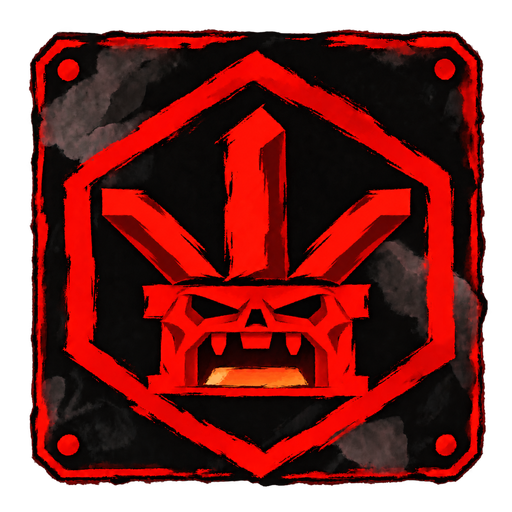

[English](README.md) · [Русский](README.ru.md)

# Gregulas



GregulasM a.k.a Gregulas.\
Разработчик на C# и Nuxt.js.\
Создатель вселенной Delusive Vortex.\
Создатель серии модов и карт для Minecraft "Delusive Vortex".

Начинающий разработчик на Rust

Люблю TUI и красивые интерфейсы

Без ума от AI и жду создания Синтетического Бога

Кручусь в [Molten-Zharr](https://github.com/molten-zharr)

<p>
  <a href="https://github.com/GregulasM"></a>
  <a href="https://github.com/molten-zharr"></a>
  <a href="manifesto/README.ru.md"></a>
</p>

```text
╭─ Friend-zoned by
│  C# · Rust · TypeScript · Go
│
├─ In love with
│  Nuxt.js · Tailwind CSS 4
│
╰─ Praying to
   TUI · UI · AI
```

<br clear="right">


## Глубоко обожаемое

<p>
  
  
  
</p>

Molten-Zharr - мой храм и мой бастион.\
ПО, которым хочется пользоваться, ПО, которым удобно пользоваться.

**Удобство или удаление**

[Наш манифест](manifesto/README.ru.md)

## Проекты Molten-Zharr

| Проект | Что он делает |
|---|---|
| [Almavorn](https://github.com/Molten-Zharr/Almavorn) | **Наш флагман.** Музыкальный плеер для Linux: в отдельном окне и в терминале. Своя музыка. Свои клавиши. Свое расположение. Полный кастом. |
| [Basalgrim](https://github.com/Molten-Zharr/Basalgrim) | Файловый менеджер для Linux. Работай с файлами в окне или терминале, мышью и клавиатурой. |
